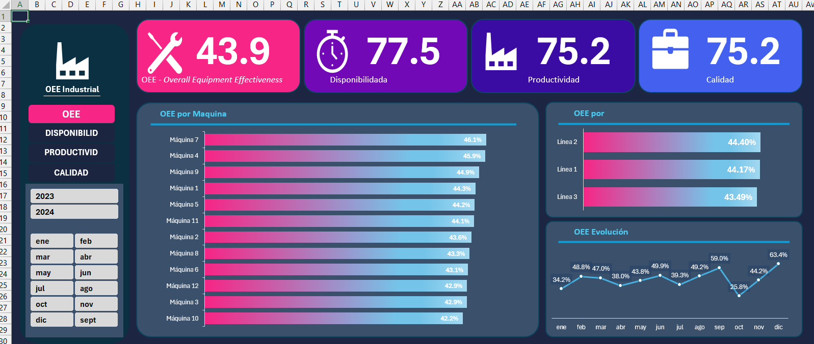
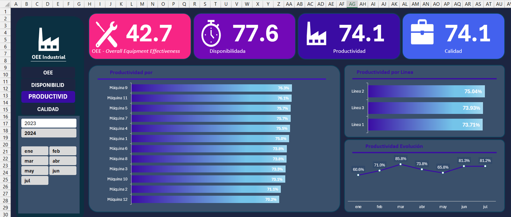
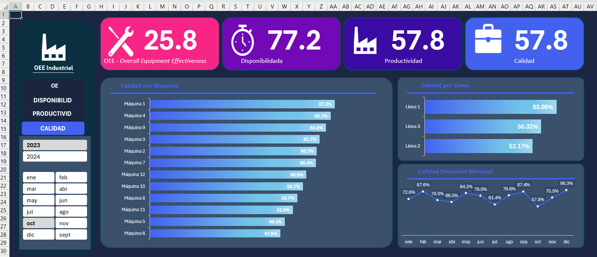

# 🏭 Proyecto de Análisis y Optimización Operacional (OEE Industrial)

## 📌 El desafío de negocio: explorar sin una pregunta definida

Este proyecto comenzó con una base de datos de producción de **6.924 filas y 9 columnas**, sin una pregunta de negocio previamente definida.

El desafío consistió en explorar los datos, comprender los indicadores industriales, formular preguntas de análisis e identificar oportunidades de investigación sobre el desempeño de la operación.

El análisis abarcó **3 líneas de producción y 12 máquinas**, utilizando información histórica del período enero de 2023 a julio de 2024.

El objetivo fue transformar los datos en indicadores y visualizaciones que facilitaran la exploración de resultados y la toma de decisiones.

---

## 🛠️ Tecnologías y herramientas

- **Preparación y limpieza:** Microsoft Excel.
- **Análisis exploratorio:** tablas dinámicas, campos calculados y variables auxiliares.
- **Visualización:** gráficos dinámicos, tarjetas KPI y segmentadores.
- **Navegación:** hipervínculos entre dashboards.
- **Entregables:** archivo Excel.

---

## 📐 Marco conceptual: ¿qué es el OEE?

El OEE (*Overall Equipment Effectiveness*), o Eficiencia Global del Equipo, permite evaluar el desempeño de una operación productiva a partir de tres componentes.

| Indicador | Fórmula utilizada |
|---|---|
| Disponibilidad | Horas productivas / Horas programadas |
| Productividad | Piezas buenas / Piezas programadas |
| Calidad | Piezas buenas / Total de piezas producidas |
| OEE | Disponibilidad × Productividad × Calidad |

Además, se analizaron métricas relacionadas con los tiempos de producción, las piezas programadas y los resultados de calidad.

---

## 🗃️ Preparación de los datos

La base contenía variables temporales, operativas y de producción. Se revisaron los tipos de datos, los valores vacíos, la consistencia de los registros y los cálculos relevantes.

Durante el procesamiento se incorporaron las variables auxiliares **Año** y **Mes**, derivadas de la fecha original, para facilitar el análisis temporal.

La revisión también permitió detectar inconsistencias en fórmulas de algunos registros, lo que destacó la importancia de validar los datos antes de interpretar los indicadores.

---

## 📊 Análisis y descubrimientos clave

### Indicadores generales

| Indicador | Resultado |
|---|---:|
| OEE global | 43,95 % |
| Disponibilidad | 77,56 % |
| Productividad | 75,27 % |
| Calidad | 75,27 % |

### Hallazgos principales

- **Desempeño por línea:** la Línea 2 obtuvo el OEE más alto, con 44,40 %, mientras que la Línea 3 registró el más bajo, con 43,49 %. Las diferencias entre líneas fueron pequeñas.
- **Desempeño por máquina:** la Máquina 7 presentó el OEE más alto, con 46,1 %, y la Máquina 10 el más bajo, con 42,2 %.
- **Variación temporal:** diciembre registró el OEE más alto, con 63,4 %, mientras que octubre presentó el más bajo, con 25,8 %.
- **Disponibilidad:** se mantuvo relativamente estable entre los meses analizados.
- **Productividad:** mostró variaciones mensuales más pronunciadas, desde 57,8 % en octubre hasta 90,3 % en diciembre.

La igualdad entre los resultados generales de productividad y calidad constituye una observación relevante de este conjunto de datos. Su interpretación debe considerar las relaciones entre las piezas programadas, las buenas y las defectuosas.

Estos hallazgos permiten identificar dónde profundizar el análisis, pero no determinan por sí solos las causas de las diferencias observadas.

**Nota sobre los indicadores:** En este conjunto de datos, la productividad y la calidad obtuvieron el mismo resultado (75,27 %), debido a que las piezas programadas coinciden con el total de piezas producidas. Para este análisis, la productividad se calculó como la relación entre piezas buenas y piezas programadas.

---

## 📉 Dashboard de Excel

El proyecto contempla cuatro dashboards, diseñados para consultar los indicadores desde distintas perspectivas:

1. **OEE Industrial:** visión general, comparación entre máquinas y líneas, y evolución temporal.
2. **Disponibilidad:** análisis del tiempo productivo respecto del tiempo programado.
3. **Productividad:** comparación del cumplimiento de producción mediante las piezas buenas y programadas.
4. **Calidad:** seguimiento de la proporción de piezas buenas respecto del total producido.

Las visualizaciones incorporan gráficos, tarjetas de indicadores, segmentadores temporales y navegación entre hojas.

> **⚠️ NOTA:** Para poder visualizar e interactuar con el Dashboard por completo, por favor **[descarga el archivo Excel aquí](Proyecto_de_Análisis_y_Optimizacion_Operacional_(OEE_Industrial).xlsx)**. ¡Muchas gracias!

---

## 🎯 Oportunidades de mejora identificadas

A partir de los resultados se proponen las siguientes líneas de investigación:

- **Revisión de máquinas:** comparar disponibilidad, productividad y calidad en las máquinas con menor OEE para identificar dónde se concentra la diferencia.
- **Análisis de períodos críticos:** investigar octubre y otros períodos de bajo desempeño para determinar qué componente explica principalmente la variación.
- **Seguimiento de indicadores:** monitorear disponibilidad, productividad y calidad por separado para evitar que el OEE global oculte diferencias relevantes.
- **Profundización del análisis:** incorporar información adicional de producción y mantenimiento para investigar las posibles causas de los resultados.

Las propuestas constituyen oportunidades de investigación y no diagnósticos confirmados de fallas operacionales.

---

## 🧠 Aprendizajes del proyecto

Este ejercicio permitió desarrollar habilidades para:

1. Explorar una base de datos sin requerimientos de negocio previamente definidos.
2. Preparar y validar información antes de analizarla.
3. Construir indicadores industriales mediante campos calculados.
4. Comparar resultados por línea, máquina y período.
5. Diseñar dashboards interactivos en Excel.
6. Comunicar hallazgos y proponer investigaciones posteriores a partir de la evidencia disponible.

**Aprendizaje principal:** el análisis de datos no siempre comienza con una pregunta definida. Parte del trabajo consiste en descubrir qué preguntas vale la pena hacer y cómo transformar los resultados en información útil para orientar decisiones.

---

## 📁 Contenido del repositorio

- **Resumen del caso:** contexto, metodología y principales hallazgos.
- **Dashboard en PDF:** versión ejecutiva para explorar rápidamente los resultados.
- **Archivo Excel:** datos, cálculos, tablas dinámicas y dashboards del proyecto.

Los enlaces a los archivos se incorporarán una vez definidas las rutas finales del repositorio.

